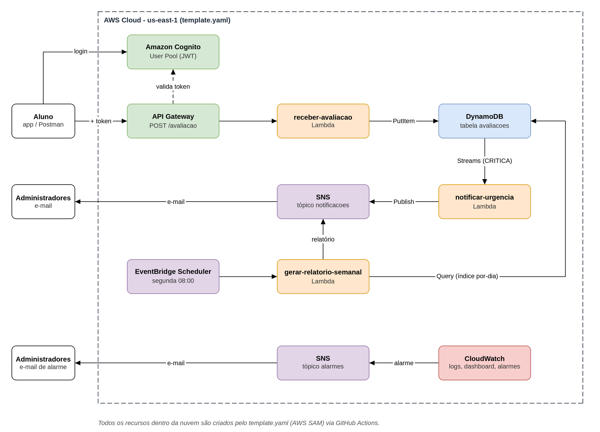

# Plataforma de Feedback de Aulas - FIAP Tech Challenge Fase 4

Projeto do Tech Challenge da fase 4 da Pós Tech ADJT. É uma plataforma serverless na AWS em que os
alunos avaliam as aulas e os administradores recebem um e-mail quando chega uma avaliação crítica,
além de um relatório semanal com a média das notas.

A infraestrutura toda está em código ([template.yaml](template.yaml), AWS SAM) e o deploy roda
sozinho pelo GitHub Actions a cada push na `main`.

**Vídeo de demonstração:** _link a ser adicionado_

**Grupo:** Igor (funções, IaC e pipeline), Caio (monitoramento e segurança) e Luciano (autenticação,
documentação e vídeo).

## Sumário

- [Arquitetura](#arquitetura)
- [Modelo de nuvem](#modelo-de-nuvem)
- [Funções](#funções)
- [Monitoramento](#monitoramento)
- [Segurança e governança](#segurança-e-governança)
- [Estrutura do repositório](#estrutura-do-repositório)
- [Desenvolvimento local](#desenvolvimento-local)
- [Deploy passo a passo](#deploy-passo-a-passo)
- [Testando com o Postman](#testando-com-o-postman)

## Arquitetura

O documento de arquitetura completo está em [docs/arquitetura.pdf](docs/arquitetura.pdf) (modelo de nuvem,
componentes, comunicação entre os serviços, modelo de dados, dependências e segurança). O diagrama foi feito
no draw.io e o arquivo editável é o [docs/arquitetura.drawio](docs/arquitetura.drawio).



### Fluxo de uma avaliação

1. O aluno se autentica no Cognito com usuário e senha e recebe um token de acesso (JWT, válido por 1 hora).
2. O aluno envia `POST /avaliacao` com `descricao`, `nota` e o cabeçalho `Authorization: Bearer <token>`.
   O API Gateway confere a assinatura, a validade e o emissor do token; sem token válido responde `401`
   e a função nem é chamada.
3. A `receber-avaliacao` valida o corpo, calcula a urgência pela nota e grava o item no DynamoDB. O aluno recebe `201` na hora.
4. A gravação gera um evento no DynamoDB Streams. Se a urgência for `CRITICA`, o evento aciona a `notificar-urgencia`, que publica o aviso no SNS e o administrador recebe o e-mail.
5. Toda segunda-feira às 08:00 o EventBridge Scheduler aciona a `gerar-relatorio-semanal`, que lê as avaliações dos 7 dias anteriores e envia o relatório pelo mesmo tópico.
6. O CloudWatch acompanha as três funções e a API. Quando algo dá errado, um alarme manda e-mail por um tópico SNS separado.

Como o aviso de urgência é disparado pelo Streams, e não pela própria `receber-avaliacao`, uma falha no
envio do e-mail não afeta a resposta ao aluno: a avaliação já está gravada e o envio é tentado de novo.

### Componentes

| Componente | Serviço AWS | Papel |
|---|---|---|
| Autenticação | Amazon Cognito User Pool | Cadastro dos alunos e emissão do token JWT exigido pela API |
| API | API Gateway HTTP API | Expõe `POST /avaliacao` em HTTPS, com JWT authorizer e throttling |
| Funções | AWS Lambda (Java 21, arm64) | Uma responsabilidade por função |
| Banco | DynamoDB on-demand, criptografado, com Streams | Guarda as avaliações e dispara o aviso de urgência |
| Notificação | SNS com assinatura de e-mail | Entrega o aviso de urgência e o relatório |
| Agendamento | EventBridge Scheduler | Dispara o relatório toda semana |
| Logs | CloudWatch Logs | Registro de execução das funções e acesso à API (retenção de 30 dias) |
| Monitoramento | CloudWatch Dashboard e Alarms | Painel das funções/API e 9 alarmes enviados por e-mail (tópico SNS separado) |
| Governança | IAM, CloudTrail, AWS Budgets | Papel próprio por função, auditoria e alerta de orçamento |

### Regra de urgência

O enunciado não define o que é urgência, então adotamos a regra abaixo:

| Nota | Urgência | Envia e-mail imediato? |
|---|---|---|
| 0 a 3 | `CRITICA` | Sim |
| 4 a 6 | `MEDIA` | Não |
| 7 a 10 | `BAIXA` | Não |

A urgência é calculada em `receber-avaliacao` e gravada junto com a avaliação.

## Modelo de nuvem

**Modelo de implantação: nuvem pública (AWS).** Não há servidor próprio nem on-premises; tudo roda
na infraestrutura da AWS, região `us-east-1`.

**Modelo de serviço: serverless**, combinando:

- **FaaS (Function as a Service)** para o código: as três funções rodam no AWS Lambda. Não existe
  servidor ligado esperando requisição; a função sobe quando chega um evento e a cobrança é por execução.
- **Serviços gerenciados** para dados, mensageria e identidade: DynamoDB, SNS, EventBridge Scheduler,
  API Gateway e Cognito.
  A AWS cuida de disponibilidade, escala, atualizações e backup; o grupo só configura.
- **Infraestrutura como código (IaC):** tudo está declarado em [template.yaml](template.yaml) (AWS SAM,
  que vira CloudFormation). O ambiente inteiro é recriado com um `sam deploy`, sem clicar no console.

### Por que serverless

- O uso é esporádico (alunos avaliam depois das aulas, relatório uma vez por semana). Com servidor
  ligado o tempo todo pagaríamos pelo tempo ocioso; com Lambda e DynamoDB on-demand o custo acompanha o uso
  e fica dentro da camada gratuita no volume do projeto.
- O problema é naturalmente orientado a eventos: chega uma avaliação, grava; gravou uma crítica, avisa;
  chegou segunda-feira, consolida. Cada evento vira o gatilho de uma função.
- Não há sistema operacional, patch ou escala para administrar, o que importa num ambiente com créditos limitados.

### Por que AWS

| Critério | AWS | Azure | GCP |
|---|---|---|---|
| Funções | Lambda | Functions | Cloud Functions / Cloud Run |
| Banco NoSQL serverless | DynamoDB on-demand | Cosmos DB | Firestore |
| Agendamento | EventBridge Scheduler | Timer Trigger | Cloud Scheduler |
| E-mail sem domínio próprio | SNS com assinatura de e-mail | Exige domínio ou Logic Apps | Sem serviço nativo (SendGrid etc.) |
| IaC | SAM: um único template YAML | Bicep/ARM | Terraform ou gcloud |

O que mais pesou foi o e-mail. Com o SNS o administrador só precisa confirmar a assinatura para receber o
aviso e o relatório, sem comprar domínio nem depender de serviço de terceiros. Também ajudou o SAM permitir
colocar funções, API, tabela, agendamento, alarmes e permissões num arquivo só, o que facilita o deploy automático.

## Funções

Cada função tem uma única responsabilidade: uma grava, outra avisa e outra consolida. Elas não chamam
umas às outras; a comunicação é feita pelos eventos da AWS (API Gateway, DynamoDB Streams e EventBridge).

| Função | Responsabilidade | Gatilho | Saída |
|---|---|---|---|
| `receber-avaliacao` | Validar e gravar a avaliação | `POST /avaliacao` | Item no DynamoDB e resposta `201` |
| `notificar-urgencia` | Avisar sobre avaliações críticas | DynamoDB Streams | E-mail de urgência via SNS |
| `gerar-relatorio-semanal` | Consolidar a semana | EventBridge Scheduler | E-mail do relatório via SNS |

Nos nomes reais das funções aparece o ambiente no final (ex.: `receber-avaliacao-dev`).

### receber-avaliacao

- **Responsabilidade:** validar e gravar a avaliação.
- **Gatilho:** `POST /avaliacao` (API Gateway HTTP API), só depois que o JWT authorizer aceita o token.
- **Variáveis de ambiente:** `TABELA_AVALIACOES` (nome da tabela), `FUSO_HORARIO` (fuso usado para o campo `dia`).
- **Permissões:** apenas `dynamodb:PutItem` na tabela.
- **Código:** [src/receber_avaliacao](src/receber_avaliacao)

**Entrada**

```json
{ "descricao": "O áudio da aula 3 está inaudível", "nota": 2 }
```

| Campo | Regra |
|---|---|
| `descricao` | Texto obrigatório, não pode ser vazio (espaços nas pontas são removidos), até 2000 caracteres |
| `nota` | Número inteiro de 0 a 10. `"7"` (texto), `7.5` e `7.0` são rejeitados |

**Respostas**

| Status | Quando |
|---|---|
| `201 Created` | Avaliação válida e gravada |
| `400 Bad Request` | Corpo vazio, JSON inválido, campo ausente, tipo errado ou fora do limite. Todos os erros vêm juntos na lista `erros` |
| `401 Unauthorized` | Sem cabeçalho `Authorization`, token expirado, adulterado ou de outro emissor (a função nem é chamada) |
| `429 Too Many Requests` | Limite de requisições da API excedido (a função nem é chamada) |
| `500 Internal Server Error` | Falha inesperada ao gravar. Dispara o alarme de erros |

Exemplo de chamada:

```bash
curl -X POST "$API_URL" \
  -H "Content-Type: application/json" \
  -H "Authorization: Bearer $TOKEN" \
  -d '{"descricao": "O áudio da aula 3 está inaudível", "nota": 2}'
```

O `$TOKEN` vem de `./scripts/obter-token.sh <usuario>` (veja o [passo 5 do deploy](#5-cadastrar-um-aluno-e-obter-o-token)).

Resposta `201`:

```json
{
  "id": "6f1c2a52-...",
  "descricao": "O áudio da aula 3 está inaudível",
  "nota": 2,
  "urgencia": "CRITICA",
  "dataEnvio": "2026-10-06T15:00:00Z"
}
```

Resposta `400` para `{"descricao": "", "nota": 15}`:

```json
{
  "erros": [
    "O campo 'descricao' não pode ser vazio",
    "O campo 'nota' deve estar entre 0 e 10"
  ]
}
```

Item gravado no DynamoDB: `id`, `descricao`, `nota`, `urgencia`, `dataEnvio` (ISO-8601, UTC)
e `dia` (`yyyy-MM-dd` no fuso da aplicação, chave do índice `por-dia`). Nenhum dado pessoal
do aluno é armazenado.

### notificar-urgencia

- **Responsabilidade:** avisar os administradores sobre avaliações críticas.
- **Gatilho:** DynamoDB Streams. O filtro do evento só invoca a função para inserções com `urgencia = CRITICA`,
  então avaliações médias e baixas nem geram execução.
- **Saída:** e-mail via SNS com descrição, urgência e data de envio.
- **Falhas:** usa *partial batch response*; só o registro que falhou é reprocessado (até 3 tentativas),
  sem repetir e-mails que já saíram.
- **Variáveis de ambiente:** `TOPICO_ALERTA_ARN`, `FUSO_HORARIO`.
- **Permissões:** leitura do stream da tabela e `sns:Publish` no tópico de notificações.
- **Código:** [src/notificar_urgencia](src/notificar_urgencia)

E-mail recebido (assunto `[URGENTE] Nova avaliação crítica recebida`):

```
Uma avaliação com urgência crítica foi recebida na plataforma de feedback.

Descrição: O áudio da aula 3 está inaudível
Urgência: CRITICA
Data de envio: 06/10/2026 12:00:00 (America/Sao_Paulo)

Identificador: 6f1c2a52-...
```

### gerar-relatorio-semanal

- **Responsabilidade:** consolidar a semana e enviar o relatório.
- **Gatilho:** EventBridge Scheduler, toda segunda-feira às 08:00 (America/Sao_Paulo). Também pode ser invocada manualmente.
- **Período:** os 7 dias completos anteriores à execução (segunda a domingo). Avaliações do próprio dia
  da execução entram só no relatório seguinte.
- **Saída:** e-mail via SNS com média das notas, quantidade de avaliações por dia, quantidade
  por urgência e a lista de avaliações (descrição, urgência e data de envio). A lista mostra até 100
  avaliações; acima disso a média e as contagens continuam considerando todas.
- **Variáveis de ambiente:** `TABELA_AVALIACOES`, `TOPICO_RELATORIO_ARN`, `FUSO_HORARIO`.
- **Permissões:** apenas `dynamodb:Query` no índice `por-dia` e `sns:Publish` no tópico de notificações.
  A consulta é feita dia a dia pelo índice, sem varrer a tabela inteira (Scan).
- **Código:** [src/gerar_relatorio_semanal](src/gerar_relatorio_semanal)

Para gerar o relatório na hora (ex.: na demonstração):

```bash
aws lambda invoke --function-name gerar-relatorio-semanal-dev resposta.json && cat resposta.json
```

Exemplo do e-mail (assunto `Relatório semanal de avaliações - 02/11/2026 a 08/11/2026`):

```
RELATÓRIO SEMANAL DE AVALIAÇÕES
Período: 02/11/2026 a 08/11/2026

RESUMO
Total de avaliações: 3
Média das notas: 5,67

QUANTIDADE DE AVALIAÇÕES POR DIA
  02/11/2026: 0
  03/11/2026: 2
  04/11/2026: 0
  05/11/2026: 1
  06/11/2026: 0
  07/11/2026: 0
  08/11/2026: 0

QUANTIDADE DE AVALIAÇÕES POR URGÊNCIA
  CRITICA: 1
  MEDIA: 1
  BAIXA: 1

AVALIAÇÕES (descrição | urgência | data de envio)
  - Aula muito clara, exemplos excelentes | BAIXA | 03/11/2026 10:15
  - O áudio da aula 3 está inaudível | CRITICA | 03/11/2026 14:02
  - Faltou um exemplo prático no final | MEDIA | 05/11/2026 19:40

Horários no fuso America/Sao_Paulo.
```

## Monitoramento

O detalhamento completo está em [docs/monitoramento-e-seguranca.md](docs/monitoramento-e-seguranca.md). Resumo:

- **Dashboard** `plataforma-feedback-<ambiente>` no CloudWatch (link no output `DashboardUrl`): estado dos
  alarmes, invocações, erros, duração e throttles das funções, requisições, erros 4xx/5xx e latência da API,
  consumo do DynamoDB e as últimas falhas encontradas nos logs.
- **Logs** de cada função e de acesso à API em `/plataforma-feedback/<ambiente>/...`, guardados por 30 dias.
- **9 alarmes**, todos enviados por e-mail pelo tópico `plataforma-feedback-alarmes-<ambiente>`:

| Alarme | Dispara quando |
|---|---|
| Erros de cada função (3 alarmes) | 1 ou mais erros em 5 minutos |
| Duração de cada função (3 alarmes) | A execução passa de 80% do timeout |
| API 5xx | A API devolve erro de servidor a algum aluno |
| Gravação no DynamoDB | Falha ao gravar, erro de sistema ou throttling da tabela |
| Envio do aviso de urgência | O SNS recusa o aviso de uma avaliação crítica |

O tópico de alarmes é separado do tópico de avaliações, para que problema técnico não se misture com feedback
de aluno. O e-mail dos alarmes é o parâmetro `EmailAlertas`; se ficar vazio, vai para o `EmailAdministrador`.

Para testar o alarme de ponta a ponta:

```bash
./scripts/forcar-erro.sh dev   # provoca um erro; o e-mail "ALARM" chega em até 5 minutos
```

## Segurança e governança

Também detalhado em [docs/monitoramento-e-seguranca.md](docs/monitoramento-e-seguranca.md).

**Autenticação da API**

- O `POST /avaliacao` exige um token JWT emitido pelo **Amazon Cognito**. O **JWT authorizer** do API Gateway
  confere a assinatura, o emissor (o User Pool da pilha), o público (o App Client da API) e a validade antes de
  chamar a função. Sem token válido a resposta é `401` e nada é executado nem gravado.
- Só a equipe cadastra alunos (`./scripts/cadastrar-aluno.sh`); o autocadastro está desligado.
- Senha com no mínimo 12 caracteres, maiúscula, minúscula e número. Recuperação de conta só pelo administrador.
- Token de acesso válido por 1 hora e refresh token por 1 dia, com revogação habilitada. O Cognito não revela
  se um usuário existe quando o login falha.
- O token identifica o aluno só no Cognito: a avaliação gravada continua sem nenhum dado pessoal.

**Dados dos alunos**

- A avaliação não guarda dado pessoal: só `descricao`, `nota`, `urgencia`, data e um id gerado.
  O log de acesso da API não registra IP nem user agent.
- Criptografia em repouso no DynamoDB (chave KMS gerenciada pela AWS) e backup contínuo (point-in-time recovery, 35 dias).
- Tráfego só em HTTPS: a HTTP API não tem endpoint HTTP, e os tópicos SNS negam publicação sem TLS.
- Throttling na API (10 req/s, picos de 20) para evitar abuso; o excedente recebe `429`.

**Acesso**

- Cada função tem um papel IAM próprio com o mínimo de permissão (tabela na seção [Funções](#funções)).
  O script `./scripts/verificar-permissoes.sh dev` usa o simulador do IAM para mostrar o que cada uma pode e não pode fazer.
- O [infra/conta.yaml](infra/conta.yaml) prepara a conta: acesso do GitHub Actions por OIDC (token temporário,
  sem chave guardada), papel de execução do CloudFormation, trilha do CloudTrail para auditoria e grupo da equipe
  com MFA obrigatório.
- Credenciais nunca ficam no código: o pipeline lê dos secrets do GitHub.

**Custo**

- Tags `Projeto` e `Ambiente` em todos os recursos e alerta de orçamento mensal (US$ 10 por padrão).

## Estrutura do repositório

```
├── template.yaml                 # Infraestrutura da aplicação (AWS SAM)
├── samconfig.toml                # Configuração do sam build/deploy
├── pom.xml                       # Agregador Maven (mvn verify roda os testes das 3 funções)
├── src/
│   ├── receber_avaliacao/        # Função 1 (Maven, com testes em src/test)
│   ├── notificar_urgencia/       # Função 2
│   └── gerar_relatorio_semanal/  # Função 3
├── events/                       # Eventos de exemplo para sam local invoke
├── postman/                      # Coleção do Postman com as requisições de teste
├── requests.http                 # As mesmas requisições para VS Code / IntelliJ
├── infra/conta.yaml              # Governança da conta: OIDC do GitHub, CloudTrail, grupo da equipe
├── scripts/                      # cadastrar-aluno.sh e obter-token.sh (Cognito), forcar-erro.sh e verificar-permissoes.sh
├── docs/                         # Arquitetura (PDF e draw.io), monitoramento e segurança
└── .github/workflows/deploy.yml  # CI/CD
```

## Desenvolvimento local

Pré-requisitos: Java 21, Maven 3.9+, [AWS SAM CLI](https://docs.aws.amazon.com/serverless-application-model/latest/developerguide/install-sam-cli.html) e Docker (só para `sam local`).

```bash
# Testes unitários das três funções
mvn verify

# Build das funções
sam build

# Invocar uma função com evento de exemplo (as funções acessam a AWS real;
# copie events/env.example.json para env.local.json e ajuste os nomes/ARNs)
sam local invoke ReceberAvaliacaoFunction -e events/avaliacao-critica.json --env-vars env.local.json

# Subir a API localmente em http://127.0.0.1:3000/avaliacao (use requests.http ou o Postman)
sam local start-api --env-vars env.local.json
```

O `sam local start-api` não aplica o JWT authorizer; a exigência do token só vale na API implantada na AWS.

Os testes cobrem a validação da entrada, a regra de urgência, o filtro e o texto do aviso, o cálculo da
média e das contagens do relatório e o comportamento das funções em caso de falha.

## Deploy passo a passo

### 1. Pré-requisitos

- Conta AWS com um usuário que possa criar papéis IAM, funções Lambda, tabelas DynamoDB, tópicos SNS,
  alarmes e pilhas do CloudFormation (no primeiro deploy, o mais simples é um usuário administrador).
  Contas de laboratório que bloqueiam a criação de papéis IAM não conseguem implantar o template.
- [AWS CLI v2](https://docs.aws.amazon.com/cli/latest/userguide/getting-started-install.html) configurada
  com `aws configure` (região `us-east-1`).
- [AWS SAM CLI](https://docs.aws.amazon.com/serverless-application-model/latest/developerguide/install-sam-cli.html), Java 21 e Maven 3.9+.
- [jq](https://jqlang.github.io/jq/download/), usado pelo `scripts/obter-token.sh`.

Para conferir:

```bash
aws sts get-caller-identity
sam --version
java -version
mvn -version
```

### 2. Baixar o projeto e rodar os testes

```bash
git clone https://github.com/Igolbr/cloud-tech-challenge_fase_4.git
cd cloud-tech-challenge_fase_4
mvn verify
```

### 3. Primeiro deploy

```bash
sam build
sam deploy --parameter-overrides EmailAdministrador=seu.email@exemplo.com
```

O SAM mostra as mudanças e pergunta `Deploy this changeset? [y/N]`; responda `y`. O deploy leva alguns minutos
e cria a pilha `plataforma-feedback-dev`.

Parâmetros opcionais (acrescente no mesmo `--parameter-overrides`, separados por espaço):

| Parâmetro | Padrão | Para quê |
|---|---|---|
| `EmailAlertas` | vazio (usa o `EmailAdministrador`) | E-mail que recebe os alarmes técnicos |
| `LimiteOrcamentoMensalUsd` | `10` | Valor do alerta de orçamento. Use `0` se a conta não permitir criar orçamento |
| `Ambiente` | `dev` | `dev` ou `prod` (muda os nomes dos recursos) |
| `FusoHorario` | `America/Sao_Paulo` | Fuso das datas e do agendamento |

Ao terminar, veja as saídas da pilha:

```bash
aws cloudformation describe-stacks --stack-name plataforma-feedback-dev \
  --query "Stacks[0].Outputs" --output table
```

A saída `ApiUrl` é o endereço do `POST /avaliacao`, a `DashboardUrl` abre o painel do CloudWatch e
`CadastroAlunosId`/`ClienteApiAvaliacoesId` identificam o User Pool e o App Client do Cognito.

### 4. Confirmar as assinaturas de e-mail

A AWS manda dois e-mails "AWS Notification - Subscription Confirmation" para o endereço informado: um do
tópico de notificações (avisos e relatório) e outro do tópico de alarmes. Clique em **Confirm subscription**
nos dois. Sem isso nenhum e-mail é entregue. Se não aparecerem, confira a caixa de spam.

### 5. Cadastrar um aluno e obter o token

A API só aceita requisições autenticadas. Cadastre um aluno de teste (a senha é pedida sem aparecer na tela)
e gere o token de acesso, que vale por 1 hora:

```bash
./scripts/cadastrar-aluno.sh aluno.teste dev
TOKEN=$(./scripts/obter-token.sh aluno.teste dev)
```

### 6. Testar

```bash
API_URL=$(aws cloudformation describe-stacks --stack-name plataforma-feedback-dev \
  --query "Stacks[0].Outputs[?OutputKey=='ApiUrl'].OutputValue" --output text)

# Sem token: 401, a função nem é chamada
curl -i -X POST "$API_URL" -H "Content-Type: application/json" \
  -d '{"descricao": "Aula muito clara, exemplos excelentes", "nota": 9}'

# Avaliação positiva: 201, urgência BAIXA, nenhum e-mail
curl -i -X POST "$API_URL" -H "Content-Type: application/json" -H "Authorization: Bearer $TOKEN" \
  -d '{"descricao": "Aula muito clara, exemplos excelentes", "nota": 9}'

# Avaliação crítica: 201, urgência CRITICA e e-mail de urgência em instantes
curl -i -X POST "$API_URL" -H "Content-Type: application/json" -H "Authorization: Bearer $TOKEN" \
  -d '{"descricao": "O áudio da aula 3 está inaudível", "nota": 2}'

# Relatório semanal na hora
aws lambda invoke --function-name gerar-relatorio-semanal-dev resposta.json && cat resposta.json
```

Lembrando que o relatório considera os 7 dias anteriores ao dia da execução: avaliações enviadas hoje só
aparecem no relatório gerado a partir de amanhã.

Também dá para testar pelo Postman (veja [Testando com o Postman](#testando-com-o-postman)).

### 7. Deploy automático pelo GitHub Actions

O workflow [.github/workflows/deploy.yml](.github/workflows/deploy.yml):

1. Em todo push e pull request: roda `mvn verify` (testes) e `cfn-lint` nos templates.
2. Em push na `main`: roda `sam build` e `sam deploy` na pilha `plataforma-feedback-dev` e imprime a URL da API e do dashboard.

Para ele funcionar, cadastre no repositório (**Settings > Secrets and variables > Actions**):

| Tipo | Nome | Valor |
|---|---|---|
| Secret | `AWS_ACCESS_KEY_ID` | Chave do usuário de deploy |
| Secret | `AWS_SECRET_ACCESS_KEY` | Segredo do usuário de deploy |
| Secret | `EMAIL_ADMINISTRADOR` | E-mail que recebe os avisos e o relatório |
| Secret (opcional) | `EMAIL_ALERTAS` | E-mail dos alarmes técnicos (padrão: o mesmo do administrador) |
| Variable (opcional) | `AWS_REGION` | Região (padrão `us-east-1`) |
| Variable (opcional) | `LIMITE_ORCAMENTO_USD` | Limite do alerta de orçamento mensal (padrão 10; 0 desliga) |
| Variables (OIDC) | `AWS_ROLE_ARN`, `AWS_CFN_EXEC_ROLE_ARN`, `AWS_ARTIFACTS_BUCKET` | Outputs do `infra/conta.yaml`; com elas o deploy dispensa as chaves de acesso |

Depois disso, qualquer push na `main` atualiza as funções sem passo manual. O andamento aparece na aba **Actions** do GitHub.

### 8. (Opcional) Deploy sem chave de acesso, por OIDC

Para não guardar chave da AWS no GitHub, implante uma vez o `infra/conta.yaml` com um usuário administrador
e cadastre os três outputs como variables (`AWS_ROLE_ARN`, `AWS_CFN_EXEC_ROLE_ARN`, `AWS_ARTIFACTS_BUCKET`).
O workflow passa a usar OIDC sozinho e os secrets `AWS_ACCESS_KEY_ID`/`AWS_SECRET_ACCESS_KEY` podem ser apagados.
O passo a passo completo, junto com MFA, usuários nominais e CloudTrail, está em
[docs/monitoramento-e-seguranca.md](docs/monitoramento-e-seguranca.md#passo-a-passo-de-configuração).

### Remover o ambiente

```bash
sam delete --stack-name plataforma-feedback-dev
```

Apaga funções, API, User Pool (com os alunos cadastrados), tabela (com as avaliações), tópicos, alarmes, dashboard e logs.

### Problemas comuns

| Sintoma | Causa provável |
|---|---|
| Nenhum e-mail chega | Assinatura não confirmada (passo 4) ou mensagem no spam |
| Deploy falha com `not authorized to perform: iam:CreateRole` | O usuário ou a conta não pode criar papéis IAM (veja os pré-requisitos) |
| Deploy falha no recurso `OrcamentoMensal` | Conta sem acesso ao AWS Budgets; use `LimiteOrcamentoMensalUsd=0` |
| `sam build` falha | Java 21 ou Maven fora do PATH (`java -version`, `mvn -version`) |
| API responde `401` | Falta o cabeçalho `Authorization: Bearer <token>` ou o token expirou (gere outro com `obter-token.sh`) |
| `obter-token.sh` falha com `NotAuthorizedException` | Usuário ou senha incorretos, ou o aluno não foi cadastrado no ambiente informado |
| `cadastrar-aluno.sh` falha com `InvalidPasswordException` | A senha precisa de 12 caracteres, com maiúscula, minúscula e número |
| API responde `429` | Limite de requisições atingido; espere alguns segundos |
| Relatório veio vazio | As avaliações foram enviadas no mesmo dia da execução; elas entram no relatório seguinte |
| Pipeline falha em "Credenciais AWS" | Secrets `AWS_ACCESS_KEY_ID`/`AWS_SECRET_ACCESS_KEY` (ou as variables do OIDC) não cadastrados |

## Testando com o Postman

A coleção [postman/plataforma-feedback.postman_collection.json](postman/plataforma-feedback.postman_collection.json)
tem as requisições de teste da API, cada uma com verificações automáticas do status e do corpo da resposta.

1. No Postman, clique em **Import** e selecione o arquivo da coleção.
2. Na coleção, aba **Variables**, preencha:

   | Variável | Valor |
   |---|---|
   | `apiUrl` | Saída `ApiUrl` do deploy |
   | `clienteId` | Saída `ClienteApiAvaliacoesId` do deploy |
   | `regiao` | Região do deploy (padrão `us-east-1`) |
   | `usuario` e `senha` | Aluno cadastrado com `scripts/cadastrar-aluno.sh` |

3. Rode **Obter token do aluno (Cognito)**. O token fica guardado em `tokenAcesso` e todas as outras
   requisições o enviam no cabeçalho `Authorization` (aba **Authorization** da coleção).
4. Rode uma requisição por vez ou a coleção inteira com **Run collection** (a pasta Autenticação roda primeiro).

| Requisição | Esperado |
|---|---|
| Obter token do aluno (Cognito) | `200` e token guardado em `tokenAcesso` |
| Sem token | `401` |
| Token inválido | `401` |
| Avaliação positiva (nota 9) | `201`, urgência `BAIXA` |
| Avaliação média (nota 5) | `201`, urgência `MEDIA` |
| Avaliação crítica (nota 2) | `201`, urgência `CRITICA` e e-mail de urgência |
| Descrição vazia e nota 15 | `400` com dois erros |
| Nota decimal (7.5) | `400` |
| Nota como texto ("8") | `400` |
| JSON inválido | `400` |

Quem usa VS Code ou IntelliJ pode usar o [requests.http](requests.http), com as mesmas chamadas principais
(cole em `@token` a saída de `./scripts/obter-token.sh`).

## Licença

[MIT](LICENSE)
